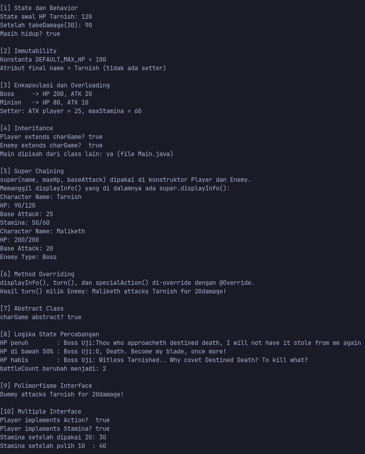
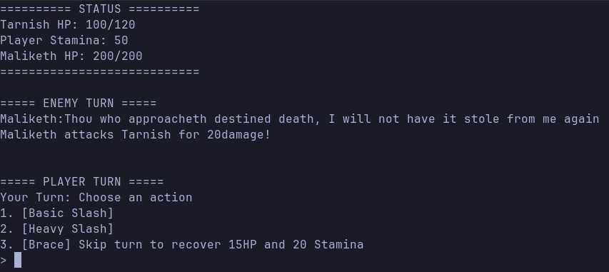
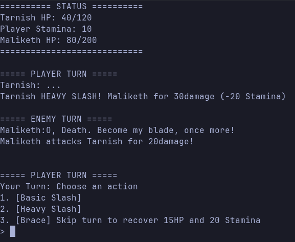
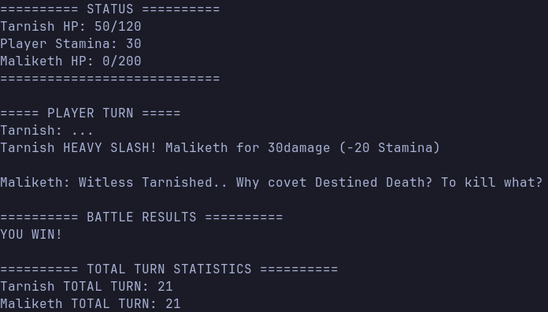
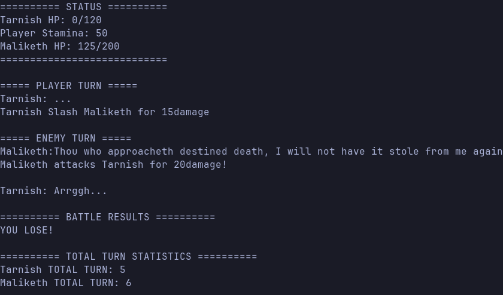

**Raditya Ghani**
**H1D025151**

# Turn Based Boss Fight di Java

Game turn based bertema fantasy yang terinspirasi dari game Elden Ring. Pemain (Tarnish) melawan salah satu boss (Maliketh) secara bergiliran sampai salah satu kalah.

Proyek ini dibuat untuk memenuhi Responsi Pemrograman Berorientasi Objek (PBO) dan mengimplementasikan 10 kriteria dalam satu project.

---

## Daftar Isi

1. [Fitur](#fitur)
2. [Struktur Proyek](#struktur-proyek)
3. [Kebutuhan Sistem](#kebutuhan-sistem)
4. [Cara Menjalankan](#cara-menjalankan)
5. [Cara Bermain](#cara-bermain)
6. [Troubleshooting](#troubleshooting)
7. [Output Gambar](#output-luaran-program)

---

## Fitur

- Pertarungan turn-based antara pemain dan boss.
- Tiga aksi pemain: **Basic Slash**, **Heavy Slash**, dan **Brace**.
- Sistem **stamina** untuk membatasi serangan kuat.
- Dialog boss yang berubah sesuai kondisi HP.
- Tampilan terminal yang diperbarui tiap giliran (layar dibersihkan, lalu status dan log ditampilkan ulang).
- Statistik **Total Turn** di akhir pertarungan.

---

## Struktur Proyek

```
Responsi-PBO/
├── .gitignore
├── README.md
└── src/
    └── TurnBasedGame/
        ├── Main.java
        ├── characters/
        │   ├── charGame.java    (abstract superclass)
        │   ├── Player.java      (subclass)
        │   ├── Enemy.java       (subclass)
        │   └── Game.java        (logika pertarungan)
        └── interfaces/
            ├── Action.java
            └── Stamina.java
```

---

## Kebutuhan Sistem

- **JDK 8 atau lebih baru** (disarankan JDK 21).
- Terminal: PowerShell, Windows Terminal, atau terminal Linux/Mac.

Cek instalasi Java:

```
java -version
javac -version
```

---

## Cara Menjalankan

Buka terminal di folder **`src`** (folder yang berisi `TurnBasedGame/`), bukan di dalam `TurnBasedGame`.

**1. Compile**

Linux / Mac / Git Bash:
```
javac TurnBasedGame/*.java TurnBasedGame/characters/*.java TurnBasedGame/interfaces/*.java
```

Windows (CMD / PowerShell):
```
javac TurnBasedGame\*.java TurnBasedGame\characters\*.java TurnBasedGame\interfaces\*.java
```

**2. Jalankan**
```
java TurnBasedGame.Main
```

Gunakan titik (bukan garis miring), tanpa `.java` atau `.class`.

---

## Cara Bermain

### Menu awal

Saat program dijalankan, kamu memilih mode:

| Pilihan | Fungsi |
|---|---|
| `1` | Menjalankan pengujian 10 persyaratan OOP |
| `2` | Memulai game |

> Sesuaikan tabel ini dengan isi `Main.java` milikmu jika menunya berbeda.

### Alur pertarungan

Setiap putaran berjalan dengan urutan:

1. Boss berbicara, lalu menyerang pemain.
2. Layar dibersihkan, lalu status dan log kejadian ditampilkan.
3. Pemain memilih aksi.
4. Hasil aksi dicatat, lalu putaran berikutnya dimulai.

Pertarungan berakhir saat HP pemain atau HP boss mencapai 0.

### Aksi pemain

Ketik angka pilihan lalu tekan **Enter**.

| Input | Aksi | Efek |
|---|---|---|
| `1` | **Basic Slash** | Damage sebesar serangan dasar (15). Tanpa biaya stamina. |
| `2` | **Heavy Slash** | Damage serangan dasar + 15 (30). Butuh minimal 20 stamina, memakai 20 stamina. |
| `3` | **Brace** | Melewati serangan untuk memulihkan 25 HP dan 20 stamina. |

Jika input tidak valid atau stamina kurang, pemain diminta memilih ulang tanpa kehilangan giliran.

### Statistik karakter

| Karakter | HP | Serangan | Stamina |
|---|---|---|---|
| Tarnish (Player) | 120 | 15 | 50 |
| Malekith (Boss) | 200 | 20 | tidak ada |

### Tips

- Heavy Slash memberi damage terbesar, tapi stamina hanya cukup untuk dua kali berturut-turut.
- Gunakan Brace untuk memulihkan HP sekaligus mengisi ulang stamina.
- Dialog boss berubah saat HP-nya turun sampai setengah atau kurang.

---

## Troubleshooting

| Masalah | Penyebab | Solusi |
|---|---|---|
| `'javac' is not recognized` | JDK belum terpasang atau belum masuk PATH | Pasang JDK, lalu cek `javac -version` |
| `Could not find or load main class TurnBasedGame.Main` | Salah folder saat menjalankan | Pindah ke folder `src`, bukan ke dalam `TurnBasedGame` |
| `package TurnBasedGame.characters does not exist` | Ada file yang tidak ikut dicompile | Pakai ketiga pola `*.java` pada perintah compile |
| Layar tidak terhapus / muncul karakter aneh | Terminal tidak mendukung kode ANSI | Pakai PowerShell, Windows Terminal, atau aktifkan terminal emulasi di IntelliJ |
| Program berhenti saat input huruf | Input tidak valid | Masukkan angka `1`, `2`, atau `3` sesuai menu |

---

## Output Luaran Program

### Pengujian 10 Persyaratan


### Tampilan Game




